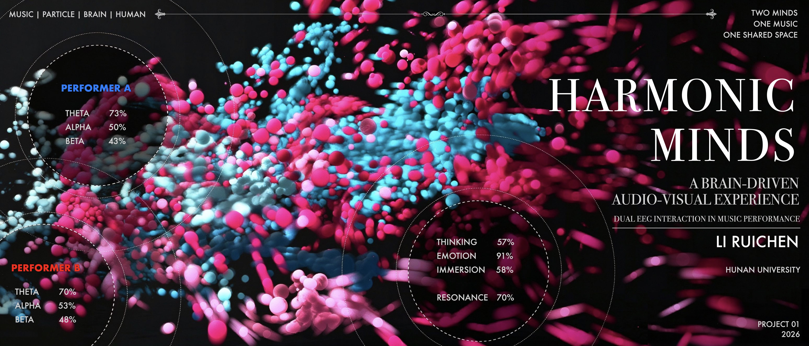
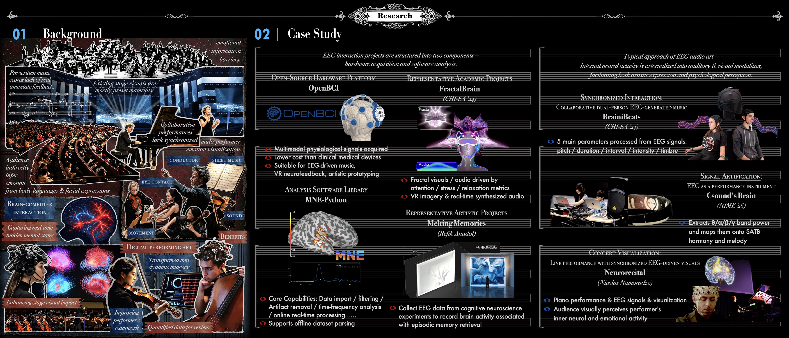
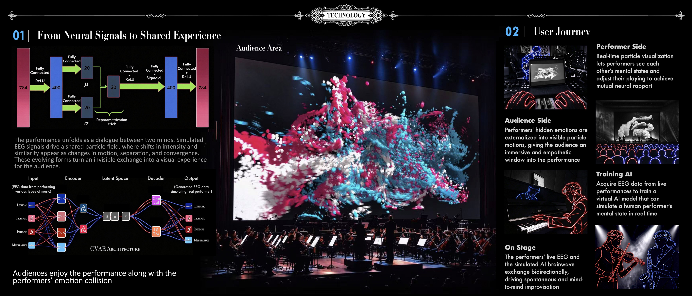
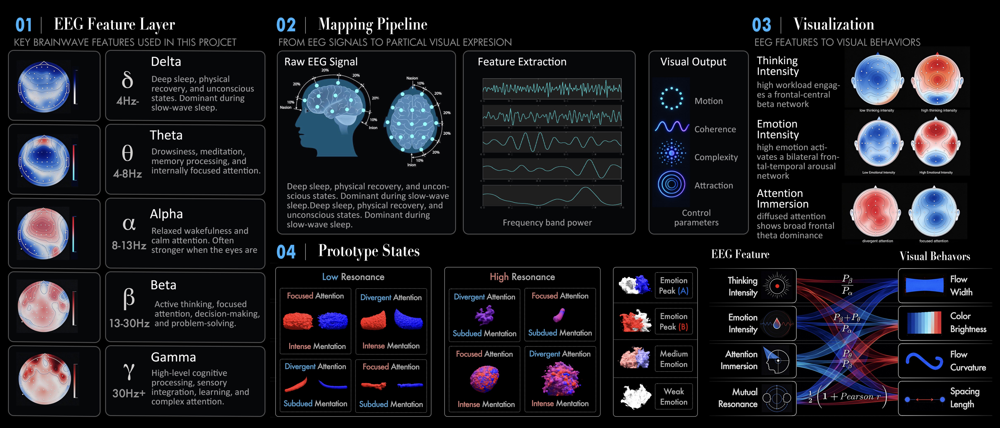
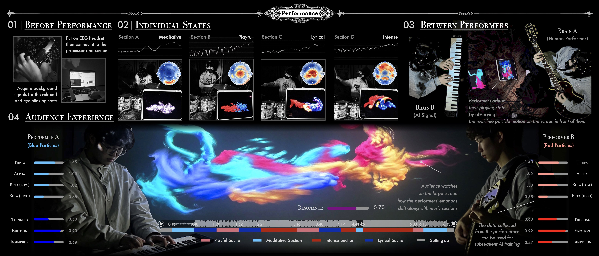

# Harmonic Minds

### A Brain-Driven Audiovisual Experience for Dual-Person EEG Interaction in Music Performance
#### CVAE EEG Signal Generation Model

> Two performers · One shared particle field · A synchronized mind-to-mind dialogue

**Harmonic Minds** is a real-time audiovisual performance system that translates the neural activity of two performers into a shared particle field. The technical core is a **Conditional VAE (CVAE)** that learns band-power distributions per musical mood (Lyrical / Playful / Intense / Meditative) and simulates a partner brainwave stream in real time.



---

## 01 | Background

Traditional performance practice has three persistent gaps:

1. **Pre-written scores** lack real-time state feedback — performers cannot react to each other's moment-to-moment mental state.
2. **Preset stage visuals** are fixed and do not reflect what is actually happening on stage.
3. **Audiences infer emotion** only from body language and facial expression — the inner neural state remains hidden.

---

## 02 | Case Study

The system is built on established open-source toolchains and references prior EEG artworks.

| Type | Project | Notes |
|---|---|---|
| Hardware | **OpenBCI** | Multimodal physiological signals; lower cost than clinical devices; suitable for EEG-driven music, VR neurofeedback, and artistic prototyping |
| Software | **MNE-Python** | Data import / filtering / artifact removal / time-frequency analysis / online real-time processing; supports offline dataset parsing |
| Academic | **FractalBrain** (CHI-EA '24) | Fractal visuals and audio driven by attention / stress / relaxation metrics; VR imagery with real-time synthesized audio |
| Academic | **BrainiBeats** (CHI-EA '23) | Collaborative dual-person EEG-generated music; 5 main parameters extracted from EEG: pitch, duration, interval, intensity, timbre |
| Artistic | ***Melting Memories*** (Refik Anadol) | Collects EEG data from cognitive-neuroscience experiments; records brain activity associated with episodic memory retrieval |
| Artistic | ***Csound's Brain*** (NIME '26) | Treats EEG as a performance instrument; extracts θ/α/β/γ band power and maps them onto SATB harmony and melody |
| Artistic | ***Neurorecital*** (Nicolas Namoradze) | Live piano performance with synchronized EEG-driven visuals; lets the audience visually perceive the performer's inner neural and emotional activity |



---

## 03 | EEG Feature Layer

Five canonical brainwave bands are extracted from each performer's signal:

| Band | Frequency  | Mental State |
|---|------------|---|
| **δ** Delta | < 4 Hz     | Deep sleep, physical recovery, unconscious states |
| **θ** Theta | 4 – 8 Hz   | Drowsiness, meditation, memory processing, inward focus |
| **α** Alpha | 8 – 13 Hz  | Relaxed wakefulness, calm attention (stronger with eyes closed) |
| **β** Beta | 13 – 30 Hz | Active thinking, focused attention, decision-making |
| **γ** Gamma | > 30 Hz    | High-level cognition, sensory integration, complex attention |

### Stage Band Selection & Qualitative Mapping

Not every band is usable on a live stage:

- **δ Delta — excluded (✗):** extreme fatigue and deep sleep; it hardly appears during a performance.
- **γ Gamma — excluded (✗):** extreme thrill and ensemble rapport, but the band is highly disrupted by environmental noise on stage.
- **θ Theta — retained (✓):** empathy, reverie, melancholic mood; rendered as slow flowing lines and cool tones.
- **α Alpha — retained (✓):** relaxation, soothing effect, calm immersion; rendered as soft halos and low-speed animation.
- **β Beta — retained (✓):** focused, intense, high cognitive load, difficult performance; rendered as quick lines.

---

## 04 | Mapping Pipeline

```
Raw EEG  ──▶  Feature Extraction  ──▶  Visual Output
(14 channels)   (band power,           Motion · Coherence ·
               attention, emotion,    Complexity · Attraction
               mutual resonance)      ── control parameters ──▶ particle field
```

### Why Use Particles as a Visual Language?

Particles were chosen because their **geometry** naturally mirrors two familiar musical primitives — the **note head** and the **audio waveform** — but their **motion** can carry what a rigid waveform cannot: a feeling of inner mental state made visible. A particle field is:

- **Fluid** — continuous and flowing, like attention itself
- **Real-time** — responds frame-by-frame to live EEG shifts
- **Uncertain** — stochastic, never repeating, mirroring the ambiguity of emotion
- **Boundless** — can spread, converge, or disperse without a fixed form

### 14-Channel Headset Regional Layout

The raw signal comes from a 14-channel headset whose electrodes are grouped by cortical region, each contributing a different functional role:

| Region | Functional Role |
|---|---|
| Prefrontal | Planning, Decision |
| Frontal | Emotion Regulation |
| Central | Motor Execution |
| Temporal | Auditory Processing |
| Parietal | Attention Integration |
| Occipital | Visual Feedback |

The layout balances sufficient spatial sampling with low computational cost, which is required for real-time stage rendering.

### Control Parameters (EEG Features → Visual Behaviors)

Four continuous control parameters drive the particle behavior, each with two anchor states:

| Control Parameter | Anchor States |
|---|---|
| Thinking Intensity | Subdued ↔ Intense |
| Attention Immersion | Divergent ↔ Focused |
| Emotion Intensity | Weak ↔ Peak |
| Mutual Resonance | Low ↔ High |

### Mapping Matrix — EEG Features to Particle Geometry

The exploration deck defines four geometry-level mappings that complement the renderer parameters above:

| EEG Feature | Particle Geometry | Formula |
|---|---|---|
| Thinking Intensity | Flow Width | `Pβ / Pα` |
| Emotion Intensity | Color Brightness | `(Pβ + Pθ) / Pα` |
| Attention Immersion | Flow Curvature | `Pθ / Pβ` |
| Mutual Resonance | Spacing Length | `½(1 + Pearson r)` |

---

## 05 | Visualization

### Mapping EEG Metrics to Particle Parameters

Two simulated EEG streams (Stream A / Stream B, each carrying α/β/θ power) are combined through **relational metrics with exponential smoothing** (τ ≈ 0.45 s), then mapped to four particle-engine parameters:

| EEG Metric | Particle Parameter | Formula |
|---|---|---|
| **Emotion** | Color Intensity (Red / Blue) | `(β + θ) / α` |
| **Immersion** | Source Count | `θ / β` |
| **Mutual Resonance** | Emitter Separation | `½(1 + Pearson r)` between A and B |
| **Thinking** | Motion Rate | `β / α` |

The resulting particle field feeds back as **visual feedback** to both performers and the audience, closing the brain-to-screen loop.

---

## 05 | Visualization

### Mapping States to Particle Morphology

- **Low Resonance regime**:
  - Intense Mentation: Focused Attention forms large, solid, well-separated red/blue particle blobs; Divergent Attention yields curved, crescent-shaped distinct color clusters.
  - Subdued Mentation: Focused / Divergent Attention shrink into slender, narrow red-blue streaks, still cleanly partitioned by color.

- **High Resonance regime**:
  - Subdued Mentation: Attention modes condense into tiny, sparse blended purple particle masses with low spread.
  - Intense Mentation: Focused Attention becomes a tightly packed mottled red-purple sphere; Divergent Attention blooms into a diffuse, turbulent mixed-color cloud.

Emotion amplitude provides an additional visual dimension:
  - Emotion Peak (A): Segregated high-saturation color masses
  - Emotion Peak (B): Chaotic overlapping red-white clusters
  - Medium Emotion: Soft desaturated blended particle aggregates
  - Weak Emotion: Sparse, pale, nearly monochromatic particle formation


---

## 07 | CVAE: From Neural Signals to Shared Experience

### Dense Baseline CVAE

A fully-connected reference autoencoder using the reparameterization trick:

```
784 ──FC+ReLU──▶ 400 ──FC──▶ μ (20)
                        └─FC──▶ σ (20)
μ, σ ── Reparameterization trick ──▶ z (20)
z (20) ──FC+ReLU──▶ 20 ──FC+Sigmoid──▶ 400 ──FC+ReLU──▶ 784
```

A Conditional Variational Autoencoder learns the joint distribution of EEG features conditioned on music mood. During performance it simulates the "partner" mind state in real time, enabling bidirectional exchange between a live performer and the simulated counterpart.

```
Input (EEG × mood)
   │
   ├── CNN / LSTM encoders per mood ──▶ latent (μ, σ, z) ── reparameterization ──▶
   │
   └──────────────── Decoder (LSTM + Concat) ──────────▶ Output (generated EEG stream)
```

### Mood-Conditioned Hybrid Architecture

- **Input:** EEG data captured from performing various types of music.
- **Encoder:** CNN and LSTM branches, conditioned on the four moods — Lyrical, Playful, Intense, Meditative.
- **Latent Space:** `μ`, `σ`, `z`.
- **Decoder:** LSTM layers with feature concatenation (`Concat`).
- **Output:** Generated EEG data simulating a real human performer.

The stage overview shows the shared particle field projected onto a large concert-hall screen, visible to both performers and the audience.

---

## 08 | Implementation & Configuration

### Project Structure

```
├── run.py                  # Training / inference entry
├── concat_performance.py   # Concatenate segments into full performance
├── timeline.txt            # Musical segment timeline configuration
├── cvae_eeg/               # Model package
│   ├── config.py           # Hyperparameters
│   ├── dataset.py          # Data loading
│   ├── model.py            # CVAE model
│   ├── train.py            # Training logic
│   └── inference.py        # Inference generation
├── data/                   # Raw collected data (CSV)
├── checkpoints/            # Trained model weights
└── generated_csv/          # Generated simulated signals
```

### Requirements

- Python 3.8+
- Dependencies:

```bash
pip install torch pandas numpy
```

### Data Format

Raw data is CSV, one row per **0.5 second**, containing 5 band-power values:

```csv
timestamp,time_s,Theta,Alpha,LowBeta,HighBeta,Gamma
```

Each segment requires 3 recording sessions, placed in the `data/` directory.

### Preprocessing

Apply artifact removal (**ICA filtering**) to remove eye blinks, facial muscle artifacts, and other noise from the raw signal. Export cleaned data as standard CSV into the `data/` directory.

### Train Models

Train a CVAE model for each musical segment using the collected signals:

```bash
python run.py --segment playful
python run.py --segment meditative
python run.py --segment intense
python run.py --segment lyrical
```

Trained weights are saved to `checkpoints/cvae_{segment}.pth`.

### Generate Simulated Signals

Use trained models to generate simulated band-power signals of specified duration:

```bash
python run.py --infer --segment playful   --duration 120
python run.py --infer --segment meditative --duration 120
python run.py --infer --segment intense   --duration 120
python run.py --infer --segment lyrical  --duration 120
```

Generated CSV files are saved in the `generated_csv/` directory.

### Concatenate Full Performance

Based on the musical segment timeline annotated in `timeline.txt`, concatenate simulated segments into a complete EEG signal for the full performance:

```bash
python concat_performance.py --prep 10 --transition 5
```

- `--prep`: Opening preparation time in seconds
- `--transition`: Crossfade duration in seconds (split equally before and after each segment switch)

Output: `generated_csv/full_performance.csv`

### Configuration — `timeline.txt` Format

```
# Start time (seconds),segment name
0,blank
16,meditative
48,lyrical
80,playful
...
END_TIME=422
```

Available segment names: `lyrical`, `playful`, `intense`, `meditative`, `blank` (rest / preparation).

### Running the Full Pipeline

The output `generated_csv/full_performance.csv` feeds the real-time particle renderer via LSL, producing the live visual score.

---

## 09 | User Journey

1. **Training AI** — Acquire EEG data from live performances to train a CVAE model that simulates a human performer's mental state in real time.
2. **Performer Side** — A real-time particle display lets performers see each other's mental state and adjust their playing to achieve mutual neural rapport.
3. **On Stage** — Live EEG and simulated brainwave exchange bidirectionally, driving spontaneous, mind-to-mind improvisation.
4. **Audience Side** — Hidden performer emotions are externalized into visible particle motion, giving the audience an immersive and empathetic window into the performance.



---

## 10 | Between Two Minds

Two simulated EEG streams (Stream A = red, Stream B = cyan/blue; each carrying α / β / θ band power) feed a shared particle field. Their signals enter the **Relational Metrics + Exponential Smoothing** stage, which produces four controlled measures: **Emotion → Color Intensity (Red / Blue)**, **Immersion → Source Count**, **Mutual Resonance → Emitter Separation**, and **Thinking → Motion Rate**. These four parameters jointly drive the **Shared Particle Field · Visual Feedback**, and the field feeds back visually to both streams, closing the mind-to-mind interaction loop.

Four characteristic dramatic states emerge:

| State | α / β / θ pattern | Visual behavior |
|---|---|---|
| **Feeling Explosion** | Sudden high β on one side | Particles burst outward |
| **Concentrated Resonance** | Both sides α-dominant, high similarity | Monochrome convergence |
| **Emotional Dislocation** | Opposite band power trends | Dual-color separation |
| **Synchronized Meditation** | Both sides θ-dominant, `r ≈ 1` | Multicolor interweaving |

### Single EEG Archetype Charts

For each dramatic state, the bar chart compares User A Power and User B Power across θ, α, β, characterizing the four archetypes: Feeling Explosion, Concentrated Resonance, Emotional Dislocation, and Synchronized Meditation.

### Dual EEG Time Trace

The dual-channel plot overlays the User A Signal, User B Signal, and Mutual Resonance curve across roughly 0–30 s, showing three consecutive phases:

1. **Similar trends** — the two signals rise and fall together.
2. **Almost reversed** — the two signals diverge into opposing trends.
3. **Synchronized** — the signals reconverge and the mutual-resonance curve rises.

---

## 11 | Visual State Contrast

Higher-order states progress from **Monochrome Convergence → Dual-Color Convergence → Multicolor Interweaving → Open Dispersion**, with particles alternating between *Approach* and *Compact / Dispersed* configurations.

### Particle State Test — State Animations

**Flattening, weakening, reaching minimum**

1. Thinking flattening → Particles converging
2. Emotion weakening → Two colors fading
3. Resonance weakening → Particles separating
4. Emotion reaching minimum → Two colors disappearing
5. Resonance reaching minimum → Colors disappearing

**Focus, diffusion, and per-side emotion change**

1. Attention focusing
2. Particles diffusing
3. A's emotion weakening → Red fading
4. B's emotion weakening → Blue fading
5. Emotion dislocating → side colors disappearing (A's emotion dislocating → Red disappearing; B's emotion dislocating → Blue disappearing)

**Activation, enhancement, and interweaving**

1. Thinking activating → New colors appearing
2. A's thinking dominating → Cool colors expanding
3. Resonance enhancing → Multiple colors converging
4. B's thinking dominating → Warm colors expanding
5. Attention diffusing → Multiple colors interweaving

### Comprehension Test

Each of the states is presented to test viewers (performers and audience samples) as a particle animation, and the visual language is evaluated against three questions:

1. **The two particle groups are distinguishable.** Viewers can tell apart the two minds' particle groups (e.g., red /blue, warm /cool clusters) even under convergence, fading, or interweaving; group separation remains legible rather than collapsing into one indistinguishable cloud.
2. **The underlying mental state is identifiable.** After watching an animation, viewers can select the matching mental state among Thinking (flattening /activating), Emotion (weakening /peak/dislocating), Resonance (weakening /enhancing/minimum), and Attention (focusing /diffusing); recognition accuracy is recorded for each state.
3. **Visual transitions are intuitively comprehensible.** Viewers evaluate each transition — fading, separating, expanding, converging, interweaving — to confirm that it is perceptible, directional, and self‑explanatory, so that shifts in mental state can be interpreted intuitively without extra annotation.

The particle visual is based on *["hyper-mix"](https://github.com/edankwan/hyper-mix)* by edankwan.



---

## 12 | Live Performance Demo

The full system is deployed as a two-performer ensemble: both musicians wear OpenBCI headsets while playing, their 14-channel EEG streams are preprocessed online (ICA artifact removal, band-power extraction), and the CVAE generates a simulated partner stream that is blended with the live signal. The combined data drives a shared particle field projected onto a stage screen — magenta for Performer A, cyan for Performer B — visible to both performers and the audience.

### Stage Performance Sequence

**1. Before Performance.** Each performer puts on the EEG headset and connects it to the processor and screen. The system first acquires background baseline signals for the relaxed state and the eye-blinking state.

**2. Individual States.** The performance is divided into four types of musical sections (**Meditative**, **Playful**, **Lyrical**, and **Intense**), each profiled with waveform trace, scalp topographic heatmap, performer photograph, and corresponding particle snapshot:

**3. Between Performers.** Brain A represents the Human Performer (e.g., guitar), while Brain B represents the AI Signal (e.g., keyboard). Performers adjust their playing state by observing the real-time particle motion on the screen in front of them.

**4. Audience Experience.** A stage dashboard reports, for each performer, Theta, Alpha, Beta (low), Beta (high), **Thinking**, **Emotion**, and **Immersion** levels, together with a shared **Resonance** value. The audience watches how the performers' emotions shift along with the music sections; data collected from the performance can be reused for subsequent AI training.

**Timeline section color legend:** Playful Section (pink), Meditative Section (cyan), Intense Section (red), Lyrical Section (blue), Setting-up (gray).



---

## 13 | Conclusion

**Harmonizing Minds** closes the loop between neural activity, musical performance, and stage imagery: hidden mental states of two performers are made visible as a shared particle field, giving the audience an empathetic window into the moment-to-moment dialogue on stage. The CVAE-based generative model lets one performer be simulated, enabling bidirectional mind-to-mind exchange even when only one human is present.

---

## Tech Stack

- **EEG acquisition:** OpenBCI (dual headset setup)
- **Signal processing:** MNE-Python (filtering, artifact removal / ICA, band-power, coherence)
- **Model:** PyTorch CVAE (CNN + LSTM encoder / decoder, reparameterization trick)
- **Real-time bridge:** Lab Streaming Layer (LSL) for EEG → rendering
- **Visualization:** custom GLSL / particle system (WebGL or TouchDesigner-style emitter field)
- **Audio:** Csound / SATB mapping for EEG-derived harmony

---

## Author

**Li Ruichen** — Hunan University

Supervised by **Xu Yang**

Project 01 · 2026