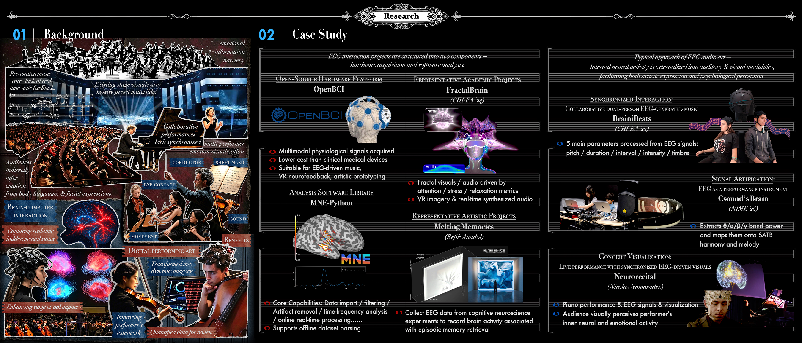
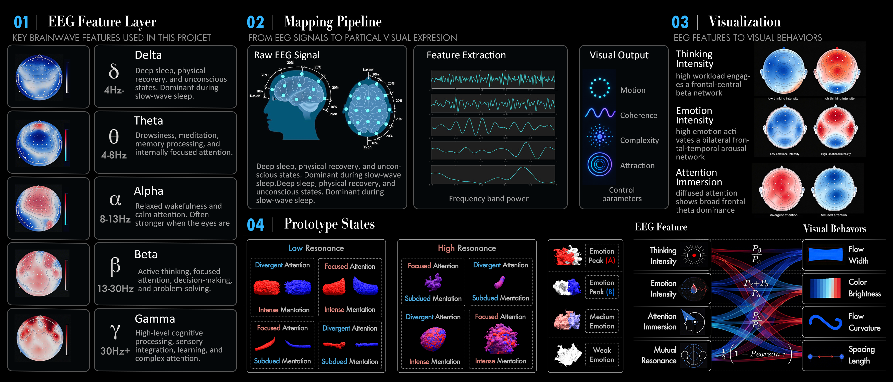
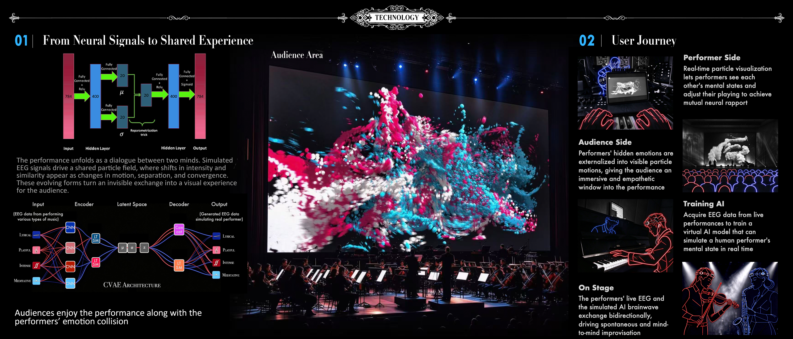

# Harmonizing Minds

### A Brain-Driven Audiovisual Experience for Dual-Person EEG Interaction in Music Performance
#### CVAE EEG Signal Generation Model

> Two performers · One shared particle field · A synchronized mind-to-mind dialogue

**Harmonizing Minds** is a real-time audiovisual performance system that translates the neural activity of two performers into a shared particle field. The technical core is a **Conditional VAE (CVAE)** that learns band-power distributions per musical mood (Lyrical / Playful / Intense / Meditative) and simulates a partner brainwave stream in real time.

- **MUSIC** · **PARTICLE** · **HUMAN**
- Project 01, 2026 · Li Ruichen, Hunan University

---

## 01 | Background

Traditional performance practice has three persistent gaps:

1. **Pre-written scores** lack real-time state feedback — performers cannot react to each other's moment-to-moment mental state.
2. **Preset stage visuals** are fixed and do not reflect what is actually happening on stage.
3. **Audiences infer emotion** only from body language and facial expression — the inner neural state remains hidden.

### Project Structure

```
├── run.py                  # Training / inference entry
├── concat_performance.py   # Concatenate segments into full performance
├── timeline.txt            # Musical segment timeline configuration
├── cvae_eeg/               # Model package
│   ├── config.py           # Hyperparameters
│   ├── dataset.py          # Data loading
│   ├── model.py            # CVAE model
│   ├── train.py            # Training logic
│   └── inference.py         # Inference generation
├── data/                   # Raw collected data (CSV)
├── checkpoints/            # Trained model weights
└── generated_csv/          # Generated simulated signals
```

---

## 02 | Case Study

The system is built on established open-source toolchains and references prior EEG artworks.

| Layer | Tools / Works | Notes |
|---|---|---|
| Hardware | **OpenBCI** | Multimodal physiological signals; lower cost than clinical devices; suitable for EEG-driven music, VR neurofeedback, and artistic prototyping |
| Software | **MNE-Python** | Data import / filtering / artifact removal / time-frequency analysis / online real-time processing; supports offline dataset parsing |
| Academic | FractalBrain (CHI-EA '24), BrainiBeats (CHI-EA '23) | Fractal visuals/audio driven by attention/stress/relaxation; collaborative dual-person EEG music with 5 parameters: pitch, duration, interval, intensity, timbre |
| Artistic | *Melting Memories* (Refik Anadol), *Csound's Brain* (NIME '26), *Neurorecital* (Nicolas Namoradze) | Memory-retrieval data sculpture; θ/α/β/γ band power mapped to SATB harmony; live piano with synchronized EEG-driven concert visualization |

### Requirements

- Python 3.8+
- Dependencies:

```bash
pip install torch pandas numpy
```



---

## 01 | EEG Feature Layer

Five canonical brainwave bands are extracted from each performer's signal:

| Band | Frequency | Mental State |
|---|---|---|
| **δ** Delta | < 4 Hz | Deep sleep, physical recovery, unconscious states |
| **θ** Theta | 4 – 8 Hz | Drowsiness, meditation, memory processing, inward focus |
| **α** Alpha | 8 – 13 Hz | Relaxed wakefulness, calm attention (stronger with eyes closed) |
| **β** Beta | 13 – 30 Hz | Active thinking, focused attention, decision-making |
| **γ** Gamma | 30 Hz+ | High-level cognition, sensory integration, complex attention |

### Data Format

Raw data is CSV, one row per **0.5 second**, containing 5 band-power values:

```csv
timestamp,time_s,Theta,Alpha,LowBeta,HighBeta,Gamma
```

Each segment requires 3 recording sessions, named `{segment}-1.csv`, `{segment}-2.csv`, `{segment}-3.csv`, placed in the `data/` directory.

---

## 02 | Mapping Pipeline

```
Raw EEG  ──▶  Feature Extraction  ──▶  Visual Output
(2 channels)   (band power,           Motion · Coherence ·
               attention, emotion,    Complexity · Attraction
               mutual resonance)      ── control parameters ──▶ particle field
```

### Preprocessing

Apply artifact removal (**ICA filtering**) to remove eye blinks, facial muscle artifacts, and other noise from the raw signal. Export cleaned data as standard CSV into the `data/` directory.

---

## 03 | Visualization

Three derived visual dimensions:

- **Thinking Intensity** — front-central β power → flow width / particle speed
- **Emotion Intensity** — (β + θ) / α → color brightness
- **Attention Immersion** — θ / β → flow curvature
- **Mutual Resonance** — `½(1 + Pearson r)` between the two performers → emitter spacing / shared-field interaction

### Train Models

Train a CVAE model for each musical segment using the collected signals:

```bash
python run.py --segment playful
python run.py --segment meditative
python run.py --segment intense
python run.py --segment lyrical
```

Trained weights are saved to `checkpoints/cvae_{segment}.pth`.

---

## 04 | Prototype States

### Generate Simulated Signals

Use trained models to generate simulated band-power signals of specified duration:

```bash
python run.py --infer --segment playful   --duration 120
python run.py --infer --segment meditative --duration 120
python run.py --infer --segment intense   --duration 120
python run.py --infer --segment lyrical  --duration 120
```

Generated CSV files are saved in the `generated_csv/` directory.



---

## 01 | From Neural Signals to Shared Experience (CVAE)

A Conditional Variational Autoencoder learns the joint distribution of EEG features conditioned on music mood. During performance it simulates the "partner" mind state in real time, enabling bidirectional exchange between a live performer and the simulated counterpart.

```
Input (EEG × mood)
   │
   ├── CNN / LSTM encoders per mood ──▶ latent (μ, σ, z) ── reparameterization ──▶
   │
   └──────────────── Decoder (LSTM + Concat) ──────────▶ Output (generated EEG stream)
```

### Concatenate Full Performance

Based on the musical segment timeline annotated in `timeline.txt`, concatenate simulated segments into a complete EEG signal for the full performance:

```bash
python concat_performance.py --prep 10 --transition 5
```

- `--prep`: Opening preparation time in seconds
- `--transition`: Crossfade duration in seconds (split equally before and after each segment switch)

Output: `generated_csv/full_performance.csv`

---

## 02 | User Journey

1. **Training AI** — Acquire EEG data from live performances to train a CVAE model that simulates a human performer's mental state in real time.
2. **Performer Side** — A real-time particle display lets performers see each other's mental state and adjust their playing to achieve mutual neural rapport.
3. **On Stage** — Live EEG and simulated brainwave exchange bidirectionally, driving spontaneous, mind-to-mind improvisation.
4. **Audience Side** — Hidden performer emotions are externalized into visible particle motion, giving the audience an immersive and empathetic window into the performance.

### Configuration — `timeline.txt` Format

```
# Start time (seconds),segment name
0,blank
16,meditative
48,lyrical
80,playful
...
END_TIME=422
```

Available segment names: `prelude`, `lyrical`, `playful`, `intense`, `meditative`, `blank` (rest / preparation).



---

## 01 | Between Two Minds

Two EEG streams (Performer A = magenta, Performer B = cyan) feed a shared particle field. Relative metrics — activation, stability, state difference `D`, and similarity `1 − D` — are exponentially smoothed (τ ≈ 0.45 s) and drive emitter speed, curl noise, emitter separation, and shared-field interaction.

Four characteristic dramatic states emerge:

| State | α / β / θ pattern | Visual behavior |
|---|---|---|
| **Feeling Explosion** | Sudden high β on one side | Particles burst outward |
| **Concentrated Resonance** | Both sides α-dominant, high similarity | Monochrome convergence |
| **Emotional Dislocation** | Opposite band power trends | Dual-color separation |
| **Synchronized Meditation** | Both sides θ-dominant, `r ≈ 1` | Multicolor interweaving |

---

## 02 | Visual State Contrast

Higher-order states progress from **Monochrome Convergence → Dual-Color Convergence → Multicolor Interweaving → Open Dispersion**, with particles alternating between *Approach* and *Compact / Dispersed* configurations.


---

## Tech Stack

- **EEG acquisition:** OpenBCI (dual headset setup)
- **Signal processing:** MNE-Python (filtering, artifact removal / ICA, band-power, coherence)
- **Model:** PyTorch CVAE (CNN + LSTM encoder / decoder, reparameterization trick)
- **Real-time bridge:** Lab Streaming Layer (LSL) for EEG → rendering
- **Visualization:** custom GLSL / particle system (WebGL or TouchDesigner-style emitter field)
- **Audio:** Csound / SATB mapping for EEG-derived harmony

---

## Author

**Li Ruichen** — Hunan University
Project 01 · 2026

*Brain · Sound · Particle · Human*

---

## Image Index (for `docs/img/`)

| File | Content |
|---|---|
| `01_research.png` | Page 1 — Research: Background & Case Study |
| `02_features.png` | Page 2 — EEG Feature Layer, Mapping Pipeline, Visualization, Prototype States |
| `03_technology.png` | Page 3 — Technology: CVAE Architecture & User Journey |
| `04_visualization.png` | Page 4 — Visualization: Between Two Minds & State Contrast |
| `05_demo.png` | Page 5 — Demo / Results / Conclusion |